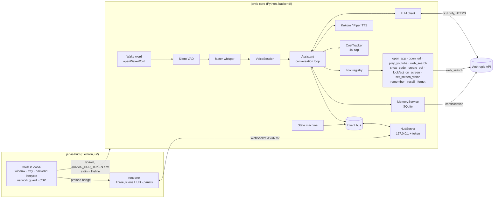

# Architecture

## Overview (all phases built)



Data never flows anywhere else: audio stays inside jarvis-core, the HUD only talks to
127.0.0.1, and jarvis-core's only outbound connection is the Anthropic API.

## Phase 1 (implemented)

```
 keyboard ──> terminal.run_repl ──> Assistant.handle_text(text)
                                        │
             ┌──────────────────────────┼─────────────────────────────┐
             │ ModelRouter.route(text) -> routine (Haiku) | coding (Sonnet)
             │ ConversationHistory (append-only, in memory)
             │ loop (max_tool_rounds):
             │   AnthropicLLMClient.respond(request, on_text)  ── streaming ──> Transcript events
             │   if tool calls: ToolRegistry.execute(...)
             │        validate input -> ToolStarted(narration) -> run (timeout) -> ToolFinished
             │        web_search -> AnthropicWebSearch (separate Claude call, server-side search)
             │   append tool results, call again
             └──────────────────────────┬─────────────────────────────┘
                                        ▼
                          EventBus ──> TerminalRenderer (prints)
                                   └─> (Phase 5: WebSocket server -> HUD)
```

### Key points

- **One event stream.** The core never prints; front-ends render events from the bus. The
  terminal in Phase 1 and the HUD in Phase 5 consume the same messages
  ([protocol.md](protocol.md)).
- **State machine** (`state.py`) is the single source of truth: IDLE → THINKING → SPEAKING
  → IDLE for typed input. LISTENING, MUTED and the follow-up window come with audio.
- **Streaming.** Text fragments are published as they arrive. Phase 2 will cut them at
  sentence boundaries and feed TTS immediately.
- **Prompt caching.** Request prefix = sorted tools + static system prompt (cache
  breakpoint) + append-only history (automatic caching). Token and cache figures are logged
  for every call.
- **Interfaces at every boundary**: `LLMClient`, `SearchProvider`, `AppLauncher`,
  `BrowserOpener`, `Confirmer`. Tests swap in fakes, so they make no network calls and
  launch nothing.

## Phase 2: push-to-talk voice (implemented)

```
 Left Ctrl held alone ≥0.3 s ── PushToTalk (GetAsyncKeyState polling, no hook)
        │ press: mic opens (pre-roll)        │ release
        ▼                                     ▼
 MicCapture (sounddevice, 16 kHz, in memory) ──audio──> WhisperSTT (faster-whisper int8, local)
   └─ audio_level{mic} ~31 Hz                              │ text + language (en/hi only)
                                                           ▼
                                   Assistant.handle_text(text, language, timer)  [background task]
                                                           │ streamed text fragments
                                                           ▼
 VoiceSpeaker: SentenceChunker ─> split_by_script ─> TTS (Kokoro/Piper) ─> postfx ─> AudioPlayer
   (cut at . ! ? । , first chunk     (Latin→en voice,     worker thread            (one open stream,
    may end at a comma)               Devanagari→hi voice)                          queue, levels)
                                                                                      │
                                         audio_started → SPEAKING, first_audio mark ◄─┘
                                         audio_idle   → THINKING while a tool runs
```

- **Half-duplex by construction.** The mic is open only while the key is held, so Jarvis
  never hears itself. Pressing the key while Jarvis talks stops playback and cancels the turn.
  The history is then repaired, so any unanswered `tool_use` gets an "interrupted" result.
- **Yes/no questions** from tools (e.g. unknown apps) are spoken. The next push-to-talk
  recording goes to the question instead of starting a new turn.
- **Latency marks** per turn, logged as `turn timing`: the clock starts at key release (end
  of speech), then `stt_ms`, `first_token_ms`, `first_audio_ms` and `total_ms`.
- **Text mode** uses `TextSpeaker`, which reports "audio" instantly. The same `Assistant`
  code drives both modes.

## Phase 3: hands-free (implemented)

`VoiceSession` (`backend/jarvis/voice.py`) reads 32 ms mic blocks from one always-open
`MicStream` and routes each one by mode:

```
             "Hey Jarvis" (score ≥ threshold)                 VAD: ≥800 ms silence
   ┌──────┐ ─────────────────────────────► greeting? ─► ┌───────────┐ ──────────────► transcribe
   │ IDLE │   (only if idle ≥ 10 min)                    │ LISTENING │                  │
   └──────┘ ◄──── no speech within timeout ───────────── └───────────┘                  ▼
      ▲                                                       ▲                     ┌──────┐
      │                follow-up window (6 s, no wake word)   │   reply finished    │ BUSY │ Claude + TTS
      └──────── silence ──────────────────────────────────────┴────────────────────└──────┘
                                                     "Hey Jarvis" (score ≥ 0.9) = barge-in ┘
```

| Mode | Mic blocks go to | Leaves on |
| --- | --- | --- |
| IDLE | wake-word detector (threshold 0.5) | wake word, push-to-talk |
| LISTENING | recording + Silero VAD + `Endpointer` | end of speech, no-speech timeout, 30 s cap |
| PTT | recording | key release |
| BUSY | wake-word detector only (0.9 while audio plays) | barge-in, push-to-talk, turn done |

- **Wake word:** `WakeWordDetector` is a port of openWakeWord's streaming pipeline
  (melspectrogram → embedding → `hey_jarvis`, one ONNX thread, 80 ms frames). It's reset
  after each detection, with a 1.5 s cooldown.
- **End of speech:** `StreamingVAD` runs faster-whisper's bundled Silero VAD v6 with its
  recurrent state kept between blocks. `Endpointer` adds hysteresis (0.5 / 0.35), ignores
  blips under 250 ms, and ends an utterance after 800 ms of silence.
- **Turn end state:** `Assistant.handle_text(..., then=LISTENING)` ends a turn in LISTENING
  instead of IDLE, so the HUD doesn't flash idle between a reply and its follow-up window.
- **Half-duplex:** audio heard while Jarvis speaks is only scored for the wake word. After a
  reply, a 300 ms guard skips the speaker's tail before the follow-up window opens.
- **Spoken confirmations** (`ask`) reuse LISTENING with purpose ANSWER; the turn waits for
  the transcribed answer.
- **Wake phrase removal:** a leading "hey jarvis" / "जार्विस" left in the transcript is
  removed before the request reaches Claude.

## Phase 4: memory and cost controls (implemented)

```
 user text ──► Assistant ──► MemoryService.note_for(text) ──► facts.rank() (local word overlap,
                │                 │                              English + Hindi keywords)
                │                 └─► note? ──► history: [..., user, system(note)] ──► Claude
                │
 EventBus ──► MemoryService (final transcripts, sensitive sentences removed) ──► buffer
                │  on IDLE/LISTENING after N user turns, or on exit (flush):
                └─► AnthropicConsolidator (Haiku, structured JSON output)
                       └─► {summary, new_facts[], outdated_fact_ids[]} ──► MemoryStore (SQLite)

 Claude tools: remember · recall_memory · forget_memory ──► MemoryService ──► MemoryStore
```

- **Store** (`memory/store.py`): one SQLite file, `%LOCALAPPDATA%\Jarvis\memory.db`. Tables
  `facts` (text, normalised text UNIQUE, category, keywords JSON, source explicit/extracted,
  timestamps) and `summary` (one row). `PRAGMA secure_delete` zeroes deleted rows;
  `user_version` guards against files from newer versions. Config refuses a `data_dir`
  inside the repository.
- **Sensitive-data guard** (`memory/sensitive.py`): password/PIN/OTP words (en + hi),
  Luhn-valid card numbers, Aadhaar/PAN/passport/SSN patterns, ID words next to numbers, API
  keys; Devanagari digits normalised first. Applied at the store (every fact write, every
  summary) and to transcripts before consolidation, so the consolidation call never sees them.
- **Recall** (`memory/facts.py`): content words of the request (stopwords and names removed)
  matched against each fact's words and keywords, exactly or by prefix (4+ letters). The top
  `recall_max_facts` with score >= `recall_min_score` go into the note. A fact or the summary
  is re-sent only after `history_max_turns` turns, when the earlier note has been trimmed.
- **Notes as mid-conversation system messages**: the system prompt and earlier history stay
  byte-identical, so prompt caching and thinking-block validity are unaffected. If the API
  rejects `role: "system"`, `AnthropicLLMClient` switches (once, for the session) to folding
  notes into the preceding user turn as `<system_note>` text.
- **Consolidation** (`memory/summary.py`): one call returns both the new rolling summary and
  new facts (with English + Hindi keywords). It sees the known facts, so it can skip
  duplicates and name contradicted ones. Failures re-queue the turns (capped at
  `max_buffered_messages`).
- **Forget wins races**: a forget clears the buffered turns, ignores the rest of that turn's
  transcripts, and bumps a generation counter so an in-flight consolidation result is
  discarded. If the summary mentions the forgotten topic, the whole summary is dropped.
- **Cost** (`cost.py`): every Claude call (conversation, search, consolidation) is priced from
  `pricing:` and added to session totals; `session usage` lines (with cache hit ratio) are
  logged on exit. One user turn's output tokens are capped across tool rounds by
  `llm.max_output_tokens_per_turn`.

## Phase 5: HUD and background service (implemented)

### Processes and start-up

```
 npm start (ui/)
   └─ Electron main ──spawn──> python -m jarvis --serve        env: JARVIS_HUD_TOKEN=<random 256-bit>
        │                         │ 1. HudServer listens on 127.0.0.1:<free port>
        │  <── stdout ─────────── │    prints JARVIS_READY {"port": N, "protocol": 2}
        │                         │ 2. TextSession answers typed input at once
        │                         │ 3. speech models load (~6 s), VoiceSession takes over
        │                         │    (voice fails? stays in TextSession, HUD shows a banner)
        ├─ preload bridge ──> renderer: {port, token}
        │                      renderer ──ws://127.0.0.1:N──> auth(token) ──> snapshot + events
        │
        └─ quit: close the backend's stdin ──> clean shutdown (memory flush, cost log);
                 killed only after 15 s. Crash: restart with backoff (1→30 s).
                 Exit code 2 (config problem, e.g. no API key): shown, not retried.
```

### Backend side

- `jarvis/server.py` (`HudServer`): `websockets` server, Origin allowlist (`app://jarvis`),
  first-message token auth (constant-time compare), validation of every command against the
  protocol models, client and size caps, non-blocking `broadcast` of bus events.
- `jarvis/hud_app.py` (`run_hud`, `Hud`): routes commands to the current session and to
  memory; builds the connect snapshot; switches TextSession → VoiceSession; watches stdin.
- `jarvis/control.py`: the `SessionControl` interface (`toggle_mute`, `interrupt`,
  `submit_text`, `ptt_start/stop`, `status`) and `TextSession` (typed-only fallback; it is
  also its own confirmer, so yes/no questions are answered by typing).
- `VoiceSession` gained the same controls. Mute closes the microphone (Windows' indicator
  goes off) and stops a running reply. Typed text answers a pending question or starts a
  turn (no follow-up window), and also works while muted. HUD push-to-talk is a
  `CommandPushToTalk` with the same hold threshold as Left Ctrl.

### HUD side (`ui/`)

| File | Role |
| --- | --- |
| `electron/main.js` | frameless window, `app://jarvis` protocol serving `dist/` with CSP headers, network guard, permission denial, IPC, tray, compact mode, start on login, single instance |
| `electron/backend.js` | spawn / ready-line parsing / restart with backoff / clean stop |
| `electron/security.js` | CSP, path-traversal-safe file mapping, request allowlist, external-link and IPC-sender checks |
| `electron/preload.cjs` | the only bridge: a handful of named calls, no Node APIs |
| `electron/icon.js` | tray/window icon drawn in code (no image files) |
| `src/ws-client.js` | reconnecting client: fresh port and token per attempt, `auth` first, backoff |
| `src/protocol.js` | version and message types read from `protocol/events.schema.json` |
| `src/hologram/core.js` | Three.js scene, bloom, easing, audio envelope, parallax, frame pacing |
| `src/hologram/states.js` | palettes, the ring `LAYERS` list, `THEME` (core, particles, bloom, camera, fade, compact) and per-state targets |
| `src/hologram/geometry.js` | procedural generators: rings, arcs, dashes, ticks, spokes, blocks, readout glyphs, flares, particles, fragments (seeded, pure, unit-tested) |
| `src/hologram/shaders/` | `palette.glsl` (gradient by radius, two-tone, chase, error, desaturation, pulse), `hud.*` (line work), `glow.*` (core, flares), `drift.*` (particles, fragments), `final.frag` (chromatic edges, hue-preserving tone curve, flicker, vignette) |
| `src/panels/` | transcript, code (highlight.js + copy), sources, memory, status bar |
| `src/shortcuts.js` | Space push-to-talk, M mute, Esc stop |
| `src/stop.js` | the Stop button; Esc and the button share `StopControl.stop()` → `interrupt` → `VoiceSession.interrupt()` (one stop path), acknowledged by `stopped` |

### The lens HUD

About 25 procedurally generated layers (`LAYERS` in `states.js`), each at its own depth so
the perspective camera gives true parallax: an iris of thin nested rings around a glowing
core, segmented thick arcs (drawn as outlines with a faint fill), thin and dashed rings,
tick dials, lens-flare hot spots, and an outer layer of spokes, small blocks and unreadable
"readout" glyph clusters. Rings rotate at their own speeds and directions; several are
tilted a few degrees. Particles and line fragments drift outward through the depth. The
camera drifts slowly and leans with the mouse. Everything is additive line work coloured by
one shared palette shader (white-hot centre to saturated edge), then UnrealBloom and a final
pass (chromatic softness at the edges, a hue-preserving tone curve, flicker, vignette).

| State | Look (targets in `states.js`, cross-faded over ~400 ms) |
| --- | --- |
| idle | dim, slow breathing, mostly blue with orange accents on one side, slow rotation |
| listening | **blue** gradient; glow, core size and an outward ring pulse follow the mic level |
| thinking | blue/orange segments chase round the rings, faster rotation, no audio reaction |
| speaking | **orange** gradient; glow, core size and ring pulse follow Jarvis's voice level |
| error | **red** with a brief flicker, held at least 1.2 s |
| muted | grey, desaturated, slow |
| offline | very dim, nearly static (backend unreachable) |

Performance: one draw call per layer (~30), additive blending without depth work, ~30 fps in
calm states on a timer (requestAnimationFrame would keep Chromium's compositor ticking at
60 Hz) and 60 fps when active; rendering stops while the window is hidden; pixel ratio capped
at 2; `powerPreference: 'low-power'`. Below 440 px (the compact window) layers marked
`compact: false` are skipped and decorative counts drop to 45%. Reduced motion: quarter-speed
rotation, no camera drift, gentler pulses, no flicker, 30% particles. Geometry and materials
are disposed on every rebuild and on `dispose()`.

## Error handling

| Failure | Behaviour |
| --- | --- |
| No network, timeout, bad key, wrong model, 5xx | `LLMError(code)` → `error` event + spoken "I could not reach my brain right now, Tony." |
| Refusal | spoken refusal line; the refused reply is not kept in history |
| Tool fails or times out | error result goes back to Claude, which tells you plainly |
| Model loops on tools | stops after `llm.max_tool_rounds`, says something went wrong |
| Bug in our code | caught at the turn boundary, logged with traceback, spoken apology |
| Mic can't open / transcription fails | "My ears aren't working right now, Tony. Check the microphone." |
| Empty transcription | "Sorry Tony, I didn't catch that." |
| Missing model files at startup | voice mode exits with "run scripts/download_models.py" |
| One sentence fails to synthesise | logged and skipped; the rest of the reply is still spoken |
| Memory recall fails | logged; the turn is answered without memory |
| Consolidation fails or times out | logged; turns stay buffered and are retried next time |
| Turn exceeds its output-token budget | stops before the next round, spoken "needs more work than I'm allowed..." |
| Memory file unreadable / from a newer version | startup stops with "Memory problem: ..." |
| Session spending would pass the cap | the call isn't made; spoken "I've reached this session's 5 dollar spending limit" |
| HUD backend crashes | Electron restarts it with backoff; HUD shows "Backend offline. Reconnecting…" |
| Backend config problem (e.g. no API key) | HUD banner with the exact message; not retried |
| Microphone / models unavailable in serve mode | typed input keeps working; banner "Voice is unavailable" |

## Screen vision mode

`jarvis/vision/gate.py` holds the one switch (`ScreenGate`, off at every start, never saved) and
`ScreenAccess`, the only path to the screen: every capture and input call checks the gate on
the event loop and again in the worker thread right before the OS call. Switching off bumps a
generation counter (work queued earlier refuses to run) and cancels tasks inside
`gate.session()`. `jarvis/vision/agent.py` runs each request as its own short Claude
conversation with the `computer_toolset_20260801` toolset (look: screenshot + zoom only; act: a
small member set), executes the calls itself with code-level rules (blocked / confirm-first key
combinations, UI Automation password-field check, `confirm_risky_action` tool), budget-checks
every request (toolset + screenshot tokens counted), caps the steps, and clears its message list
(the frames) when it ends. Only the text answer returns to the main conversation, wrapped as
untrusted; `MemoryService` drops any turn that used a screen tool. Windows capture and input
(`ImageGrab` to in-memory JPEG, `SendInput`, comtypes UI Automation) live in
`os_adapters/windows_screen.py`; the HUD excludes itself from captures with
`setContentProtection` while the mode is on.
